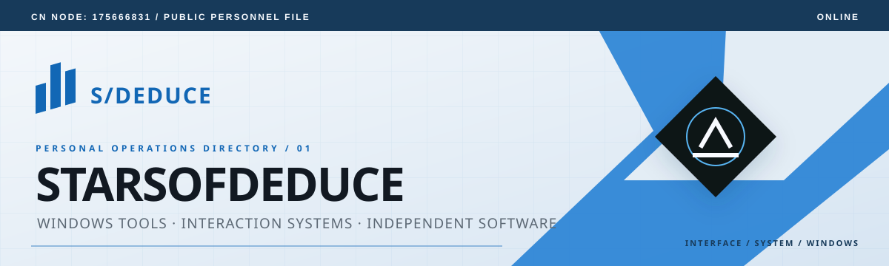
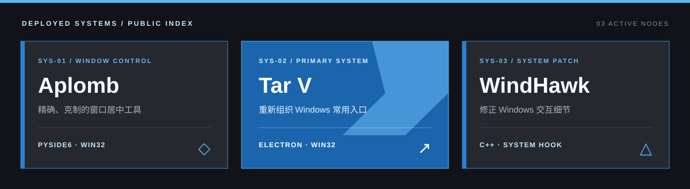

  

  <a href="https://starsofdeduce.github.io/"><strong>Website</strong></a>
  &nbsp;·&nbsp;
  <a href="https://github.com/StarsofDeduce?tab=repositories"><strong>Repositories</strong></a>
  &nbsp;·&nbsp;
  <a href="https://github.com/StarsofDeduce/StarsofDeduce/issues"><strong>Contact / Issues</strong></a>

## Personal file

> Building order at the intersection of code, systems, and interfaces.

Independent developer focused on **Windows utilities, system integration, and interface architecture**. I prefer to keep complexity below the surface so the interface stays clear, deliberate, and genuinely reduces the cost of everyday actions.

<table>
  <tr>
    <td><strong>BASE</strong> GitHub / Windows</td>
    <td><strong>FOCUS</strong> Efficiency and experience</td>
    <td><strong>STATUS</strong> Continuously building</td>
  </tr>
</table>

## Deployed systems

  

| ID | Project | Problem it solves | Technical approach |
|:---:|---|---|---|
| `SYS-01` | [**Aplomb**](https://github.com/StarsofDeduce/Aplomb) | Centers Windows applications precisely by their visible frame | Python · PySide6 · Win32 |
| `SYS-02` | [**Tar V**](https://github.com/StarsofDeduce/Tar-V) | Reorganizes frequently used Windows shortcuts into a lightweight panel | Electron · Node.js · Win32 |
| `SYS-03` | [**WindHawk**](https://github.com/StarsofDeduce/WindHawk) | Refines small but persistent Windows interaction details | C++ · system hooks |

## System stack

`Python` · `PySide6` · `C++` · `Win32` · `Electron` · `TypeScript` · `JavaScript` · `HTML/CSS` · `PowerShell`

## Knowledge archive

Development notes, implementation boundaries, and design decisions are collected on my [personal website](https://starsofdeduce.github.io/). This profile avoids decorative activity widgets and keeps only the information that explains what I am building and why.

  

<!-- GitHub's native contribution graph already appears on the profile; no third-party activity image is required. -->
